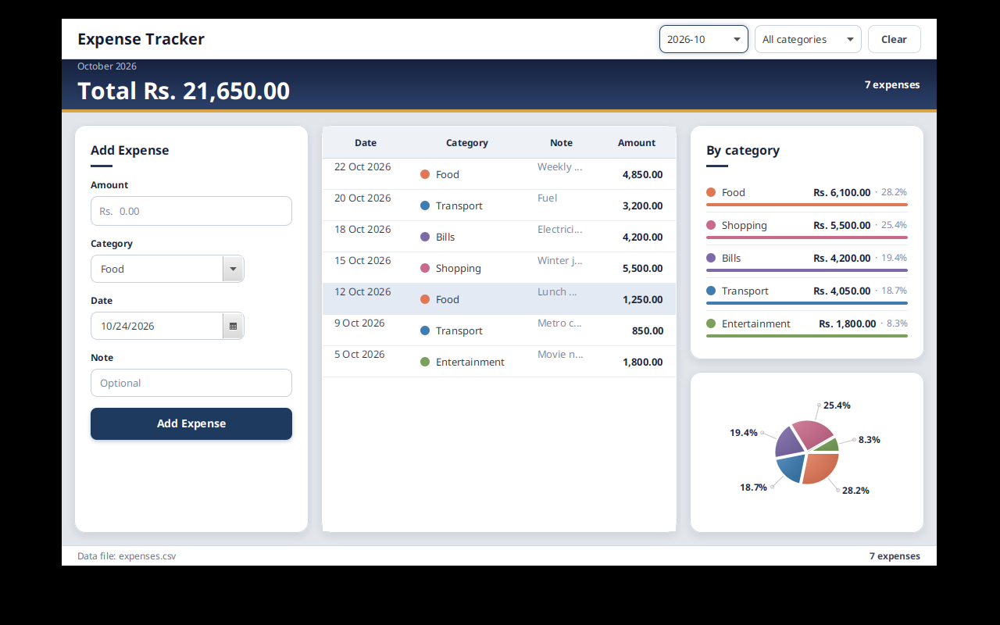

# Expense Tracker

A personal expense tracker desktop app built with JavaFX. Add expenses, filter them by month and category, and see where your money goes.



## Features

- Add, edit, and delete expenses (amount, category, date, note)
- Filter by month and category
- Month total and per-category breakdown with a pie chart
- Data saved to a local `expenses.csv` file — no account, no cloud, your data stays on your PC

## Run it

You need JDK 21 and the JavaFX SDK 21.

**Windows:**

1. Download the JavaFX SDK 21 from https://openjfx.io and unzip it, e.g. to `C:\javafx-sdk-21`
2. Open `run.bat` and set the `JAVAFX` line to your SDK's `lib` folder
3. Double-click `run.bat`

**Other systems:**

```bash
javac --module-path /path/to/javafx-sdk-21/lib --add-modules javafx.controls -d out src/*.java
cp src/style.css out/
java --module-path /path/to/javafx-sdk-21/lib --add-modules javafx.controls -cp out ExpenseTracker
```

Your expenses are stored in `expenses.csv` in the app folder. To move the app to another PC, copy the whole folder including `expenses.csv`.
